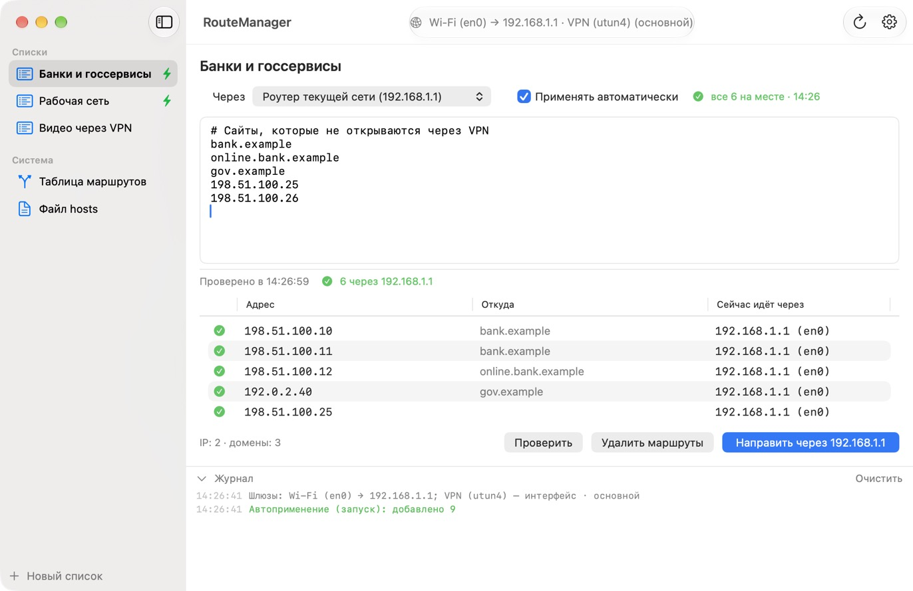
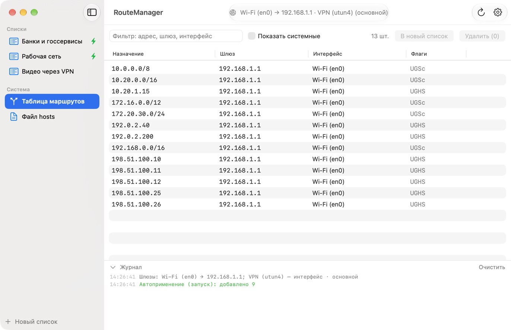
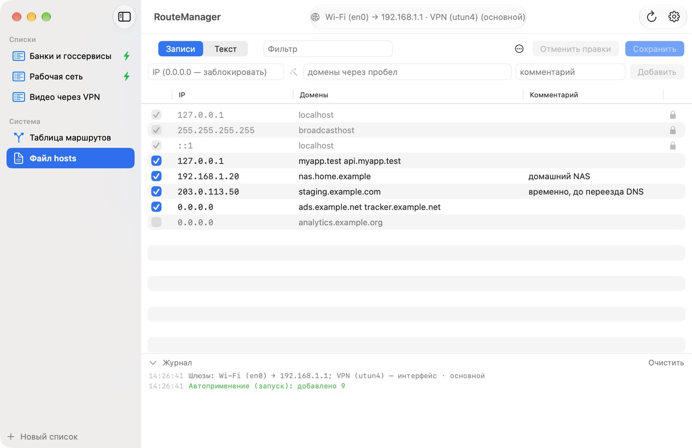
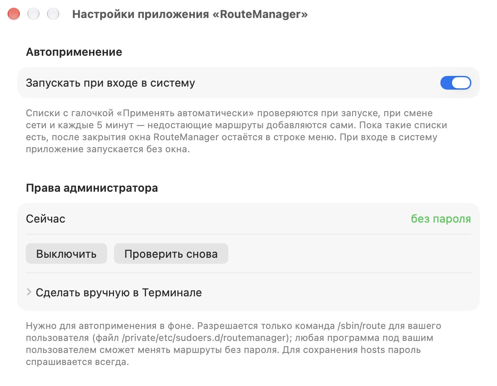

# RouteManager

**English** · [Русский](README.ru.md)

A small native macOS app for managing static routes and `/etc/hosts` — without typing `sudo route add …` in Terminal.

Paste a batch of IPs, subnets or domains and send them through the router you choose — for example, let certain sites bypass your VPN. Routes are re-applied automatically after a reboot, Wi‑Fi reconnect or network change.

> The interface is in Russian for now. A short glossary of the main buttons is [below](#ui-glossary).



## Features

- **Address lists.** IPs (`203.0.113.19`), subnets (`10.20.0.0/16`), domains (`example.com`) and even links (`https://example.org/page`) — domains are resolved to IPs. One per line or separated by spaces/commas, comments after `#`. Lists are saved between launches.
- **Gateway per list:**
  - **current network's router** (default) — the Wi‑Fi / Ethernet / iPhone hotspot router you are connected to right now; switch from home Wi‑Fi to a hotspot and the routes follow the new router;
  - a specific detected gateway or a VPN interface (`utunN`);
  - any IP entered manually.
- **One click for the whole list.** One administrator password prompt per batch; existing routes for those addresses are replaced.
- **Check.** Shows where traffic to every address actually goes right now (`route get`): ✅ through the chosen gateway, 🟠 some other way.
- **Auto-apply.** Lists marked “apply automatically” are checked on launch, on network change / wake from sleep and every 5 minutes; missing routes are added, domains are re-resolved every time. Status is shown next to the list, in the sidebar and in the menu bar.
- **Menu bar and launch at login.** With auto-apply enabled the app stays in the menu bar after you close the window; at login it starts without a window.
- **Routing table.** Static routes with a filter, delete selected (⌫), copy, create a list from the selection.
- **`/etc/hosts` editor.**
  - Table mode: on/off checkbox (a disabled line is commented out with `#`), inline editing, delete; text mode for the whole file.
  - Add entries with a “resolve IP” helper; `0.0.0.0` blocks a domain; remove duplicates.
  - Save (⌘S) with one password prompt: atomic replace + DNS cache flush. Unchanged lines and comments are kept byte for byte, `localhost` entries are protected, the previous version is backed up (last 30 kept), external changes are detected.
- **Fake-IP aware.** If your VPN client resolves domains to fake addresses (`198.18.x.x`), set an external DNS server in Settings.

| Routing table | `/etc/hosts` | Settings |
|---|---|---|
|  |  |  |

## Installation

**Requirements:** macOS 14 Sonoma or later, Apple Silicon or Intel (universal app).

### Download

1. Download **`RouteManager-1.0.0.dmg`** from [Releases](https://github.com/minion66cat/routemanager/releases/latest).
2. Open the DMG and drag **RouteManager** to **Applications**.
3. First launch. The app is not notarized by Apple, so macOS blocks it the first time:
   - open RouteManager once and close the warning;
   - go to **System Settings → Privacy & Security**, scroll down and click **Open Anyway** next to RouteManager, then confirm.

   Or remove the quarantine flag in Terminal:

   ```bash
   xattr -dr com.apple.quarantine /Applications/RouteManager.app
   ```

### Build from source

Requires Xcode or the Command Line Tools (`xcode-select --install`).

```bash
git clone https://github.com/minion66cat/routemanager.git
cd routemanager
./build.sh install
```

- `./build.sh` — build for this Mac into `build/RouteManager.app`;
- `./build.sh install` — build and copy to `/Applications`;
- `./build.sh release` — universal build (Apple Silicon + Intel) and `build/RouteManager-<version>.dmg`.

## Getting started

1. Create a list (**+ Новый список**) and paste your addresses.
2. Pick a gateway in **Через** — usually keep **Роутер текущей сети** (current network's router).
3. Click **Направить через …** (⌘↩) and enter your administrator password.
4. Click **Проверить** to see where each address goes now.
5. To survive reboots and network changes:
   - tick **Применять автоматически** (apply automatically) on the list;
   - in Settings (⌘,) click **Разрешить без пароля…** (allow without password) once;
   - turn on **Запускать при входе в систему** (launch at login).

### UI glossary

| Russian | Meaning |
|---|---|
| Списки / Новый список | Lists / New list |
| Через · Роутер текущей сети | Via · Current network's router |
| Другой IP… | Other IP… |
| Применять автоматически | Apply automatically |
| Направить через … | Route via … |
| Проверить | Check |
| Удалить маршруты | Delete routes |
| Таблица маршрутов · Показать системные | Routing table · Show system routes |
| Файл hosts · Записи / Текст · Сохранить | hosts file · Entries / Text · Save |
| Убрать дубликаты · Отменить правки | Remove duplicates · Discard changes |
| Запускать при входе в систему | Launch at login |
| Разрешить без пароля… / Выключить | Allow without password… / Turn off |
| Журнал | Log |

## Demo mode

```bash
open /Applications/RouteManager.app --args --demo
```

Fake gateways, routes, lists and hosts (documentation addresses from RFC 5737 and `*.example` domains). Nothing is changed in the system and your own lists are not touched. The screenshots above were taken in this mode.

## Permissions and security

- Changing routes requires root. By default the app asks for the administrator password with the standard macOS dialog — **once per batch**.
- Background auto-apply needs permission to run **only** `/sbin/route` via `sudo` without a password. The **Разрешить без пароля…** button creates `/private/etc/sudoers.d/routemanager` for your user (checked with `visudo` before installing). Trade-off: any program running as your user can then change routes without a password. Turn it off in Settings or with `sudo rm /private/etc/sudoers.d/routemanager`. Without it, auto-apply never prompts on its own — it shows “missing N, password needed”, and you can apply from the menu bar.
- Saving `/etc/hosts` always asks for the password. The new content is verified with SHA-256 before the file is atomically replaced.
- The app only makes DNS lookups for the domains you add. No telemetry, no other network access.

## Good to know

- Routes added with `route` live in kernel memory: they disappear after a reboot and usually after reconnecting to Wi‑Fi. That is what auto-apply is for.
- VPN clients with “strict route” / kill-switch modes may intercept traffic regardless of routes — **Проверить** shows the real path.
- IPs of CDN-hosted sites change; auto-apply re-resolves domains on every check.
- Some browsers cache DNS — after editing `/etc/hosts` you may need to restart the browser.

## Data and uninstall

- Lists: `~/Library/Application Support/RouteManager/lists.json`
- hosts backups: `~/Library/Application Support/RouteManager/hosts-backups/`

To uninstall:

1. In Settings turn off **Запускать при входе в систему** and click **Выключить** under administrator rights (or run `sudo rm /private/etc/sudoers.d/routemanager`).
2. Quit RouteManager and delete `/Applications/RouteManager.app`.
3. Optionally remove the data: `rm -rf ~/Library/Application\ Support/RouteManager`.

Routes added by the app disappear after a reboot.

## How it works

Native SwiftUI app without dependencies. It reads network state with `netstat -rn`, `route get`, `scutil --nwi`, `networksetup` and `ipconfig`, and changes routes with `/sbin/route add | change | delete` in a single script per batch.
