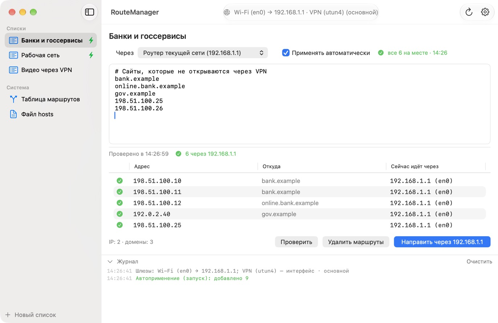
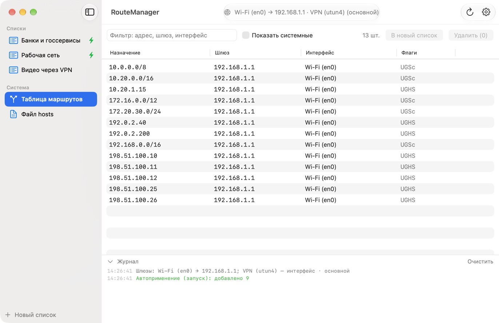
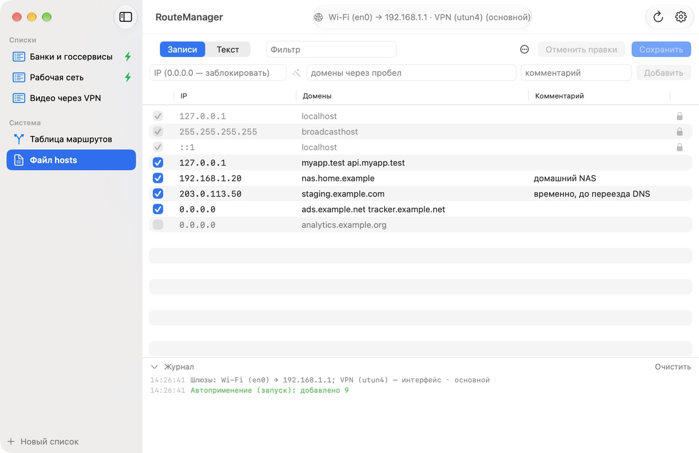
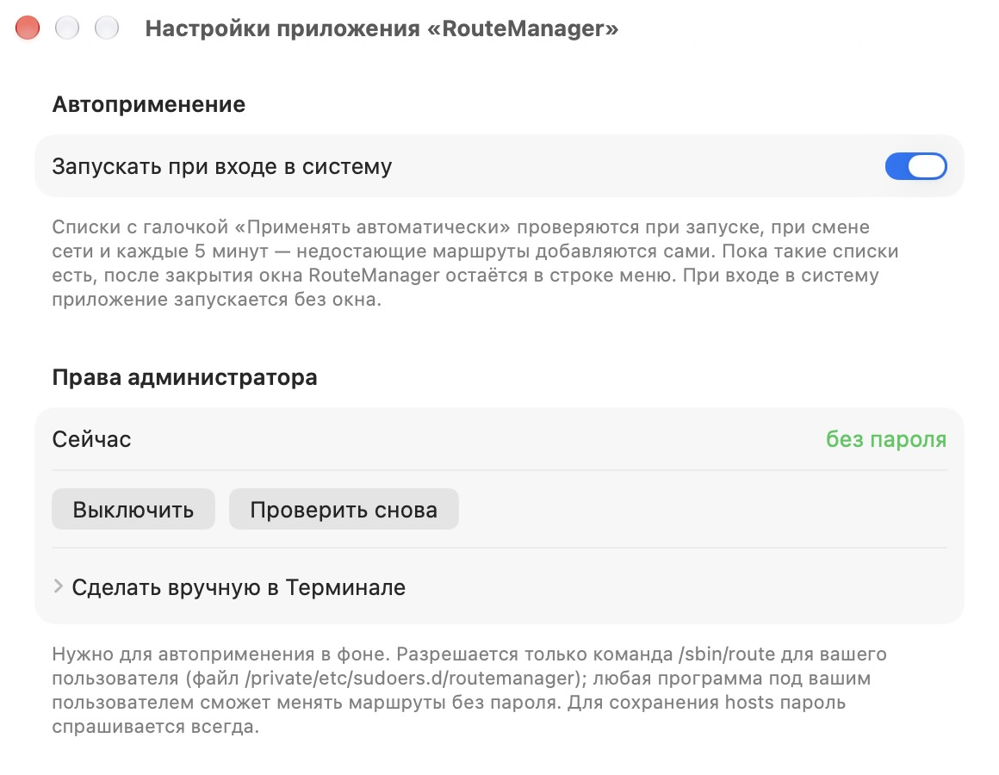

# RouteManager

[English](README.md) · **Русский**

Небольшое нативное приложение для macOS: управление статическими маршрутами и файлом `/etc/hosts` без набора `sudo route add …` в Терминале.

Вставляете пачку IP, подсетей или доменов и отправляете их через нужный роутер. Например, чтобы отдельные сайты шли мимо VPN. После перезагрузки, переподключения Wi‑Fi или смены сети маршруты применяются заново автоматически.



## Возможности

- **Списки адресов.** IP (`203.0.113.19`), подсети (`10.20.0.0/16`), домены (`example.com`) и даже ссылки (`https://example.org/page`) — домены превращаются в IP. По одному в строке или через пробел/запятую, комментарии после `#`. Списки сохраняются между запусками.
- **Свой шлюз у каждого списка:**
  - **роутер текущей сети** (по умолчанию) — роутер Wi‑Fi / Ethernet / хотспота iPhone, к которому вы подключены сейчас; перешли с домашнего Wi‑Fi на хотспот — маршруты пойдут через новый роутер;
  - конкретный найденный шлюз или VPN‑интерфейс (`utunN`);
  - любой IP вручную.
- **Весь список одной кнопкой.** Один запрос пароля администратора на пачку; существующие маршруты на эти адреса заменяются.
- **Проверка.** Показывает, куда сейчас реально идёт трафик к каждому адресу (`route get`): ✅ через выбранный шлюз, 🟠 другим путём.
- **Автоприменение.** Списки с галочкой «Применять автоматически» проверяются при запуске, при смене сети / выходе из сна и каждые 5 минут; недостающие маршруты добавляются, домены каждый раз резолвятся заново. Статус виден рядом со списком, в боковом меню и в строке меню.
- **Строка меню и запуск при входе.** С автоприменением приложение остаётся в строке меню после закрытия окна; при входе в систему стартует без окна.
- **Таблица маршрутов.** Статические маршруты с фильтром, удалением выделенных (⌫), копированием и созданием списка из выделенного.
- **Редактор `/etc/hosts`.**
  - Режим «Записи»: галочка вкл/выкл (выключенная строка комментируется `#`), правка прямо в ячейках, удаление; режим «Текст» — весь файл как есть.
  - Добавление записи с подстановкой IP домена; `0.0.0.0` блокирует домен; «Убрать дубликаты».
  - «Сохранить» (⌘S) с одним запросом пароля: атомарная замена файла и сброс DNS‑кэша. Неизменённые строки и комментарии сохраняются байт в байт, записи `localhost` защищены, прошлая версия уходит в резервную копию (хранятся 30 последних), изменения файла другими программами замечаются.
- **Режим fake‑IP.** Если VPN‑клиент подменяет адреса доменов на фиктивные (`198.18.x.x`), укажите внешний DNS в настройках.

| Таблица маршрутов | Файл hosts | Настройки |
|---|---|---|
|  |  |  |

## Установка

**Требования:** macOS 14 Sonoma или новее, Apple Silicon или Intel (универсальное приложение).

### Скачать

1. Скачайте **`RouteManager-1.0.0.dmg`** со страницы [Releases](https://github.com/minion66cat/routemanager/releases/latest).
2. Откройте DMG и перетащите **RouteManager** в **Программы** (Applications).
3. Первый запуск. Приложение не заверено Apple, поэтому в первый раз macOS его заблокирует:
   - откройте RouteManager один раз и закройте предупреждение;
   - зайдите в **Системные настройки → Конфиденциальность и безопасность**, пролистайте вниз и нажмите **«Всё равно открыть»** напротив RouteManager, затем подтвердите.

   Или снимите карантин в Терминале:

   ```bash
   xattr -dr com.apple.quarantine /Applications/RouteManager.app
   ```

### Собрать из исходников

Нужен Xcode или Command Line Tools (`xcode-select --install`).

```bash
git clone https://github.com/minion66cat/routemanager.git
cd routemanager
./build.sh install
```

- `./build.sh` — собрать под этот Mac в `build/RouteManager.app`;
- `./build.sh install` — собрать и скопировать в `/Applications`;
- `./build.sh release` — универсальная сборка (Apple Silicon + Intel) и `build/RouteManager-<версия>.dmg`.

## Как пользоваться

1. Создайте список (**+ Новый список**) и вставьте адреса.
2. В поле **Через** выберите шлюз — обычно подходит **Роутер текущей сети**.
3. Нажмите **Направить через …** (⌘↩) и введите пароль администратора.
4. **Проверить** покажет, куда сейчас идёт трафик к каждому адресу.
5. Чтобы маршруты переживали перезагрузку и смену сети:
   - поставьте у списка галочку **Применять автоматически**;
   - в настройках (⌘,) один раз нажмите **Разрешить без пароля…**;
   - включите **Запускать при входе в систему**.

## Демо‑режим

```bash
open /Applications/RouteManager.app --args --demo
```

Выдуманные шлюзы, маршруты, списки и hosts (документационные адреса из RFC 5737 и домены `*.example`). Ничего не меняется в системе, ваши списки не трогаются. Скриншоты выше сняты в этом режиме.

## Права и безопасность

- Менять маршруты может только root. По умолчанию приложение спрашивает пароль администратора стандартным окном macOS — **один раз на пачку**.
- Для автоприменения в фоне нужно разрешить запуск **только** `/sbin/route` через `sudo` без пароля. Кнопка **Разрешить без пароля…** создаёт файл `/private/etc/sudoers.d/routemanager` для вашего пользователя (перед установкой он проверяется `visudo`). Минус: после этого любая программа под вашим пользователем сможет менять маршруты без пароля. Отключить — кнопкой **Выключить** в настройках или `sudo rm /private/etc/sudoers.d/routemanager`. Без разрешения автоприменение само пароль не спрашивает, а показывает «не хватает N — нужен пароль»; применить можно из строки меню.
- Сохранение `/etc/hosts` всегда спрашивает пароль. Перед атомарной заменой файла новое содержимое сверяется по SHA‑256.
- Приложение ходит в сеть только за DNS‑запросами для добавленных вами доменов. Никакой телеметрии.

## Полезно знать

- Маршруты, добавленные через `route`, живут в памяти ядра: они пропадают после перезагрузки и обычно после переподключения Wi‑Fi. Для этого и есть автоприменение.
- VPN‑клиенты в режиме «strict route» / kill switch могут перехватывать трафик независимо от маршрутов — **Проверить** покажет реальный путь.
- У сайтов на CDN адреса меняются; автоприменение резолвит домены заново при каждой проверке.
- Некоторые браузеры кэшируют DNS — после правки `/etc/hosts` иногда нужно перезапустить браузер.

## Данные и удаление

- Списки: `~/Library/Application Support/RouteManager/lists.json`
- Резервные копии hosts: `~/Library/Application Support/RouteManager/hosts-backups/`

Как удалить:

1. В настройках выключите **Запускать при входе в систему** и нажмите **Выключить** в разделе прав администратора (или выполните `sudo rm /private/etc/sudoers.d/routemanager`).
2. Закройте RouteManager и удалите `/Applications/RouteManager.app`.
3. При желании удалите данные: `rm -rf ~/Library/Application\ Support/RouteManager`.

Маршруты, добавленные приложением, исчезнут после перезагрузки.

## Как это устроено

Нативное приложение на SwiftUI без зависимостей. Состояние сети читается через `netstat -rn`, `route get`, `scutil --nwi`, `networksetup` и `ipconfig`, маршруты меняются через `/sbin/route add | change | delete` одним скриптом на пачку.

## Лицензия

[MIT](LICENSE) © 2026 minion66cat. Программа распространяется «как есть», без каких‑либо гарантий.
